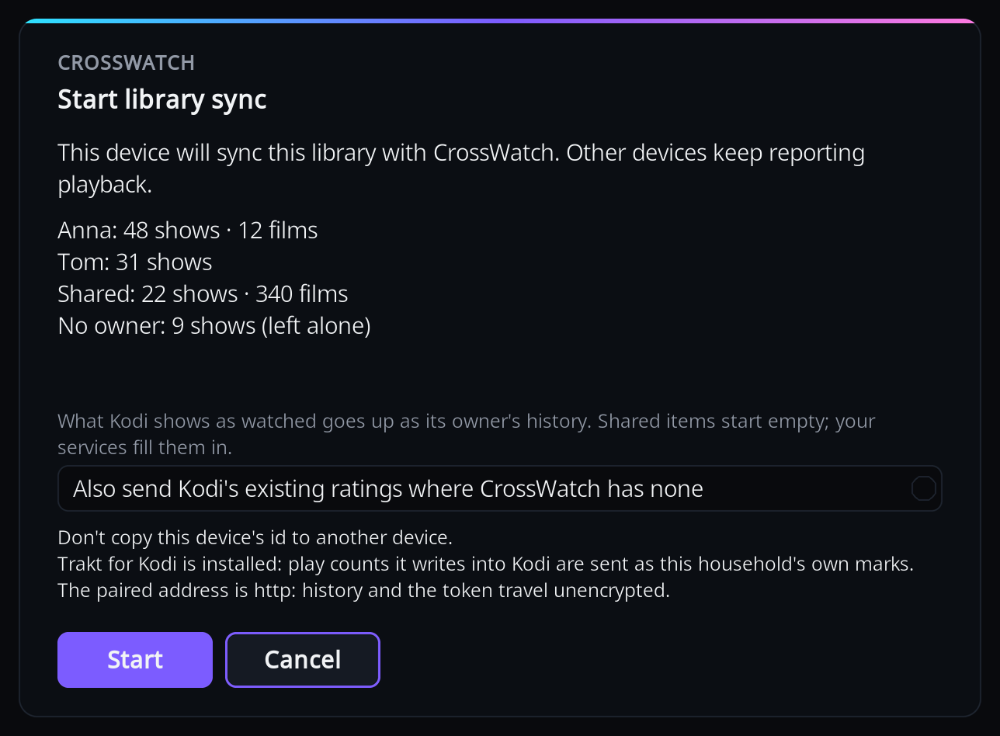
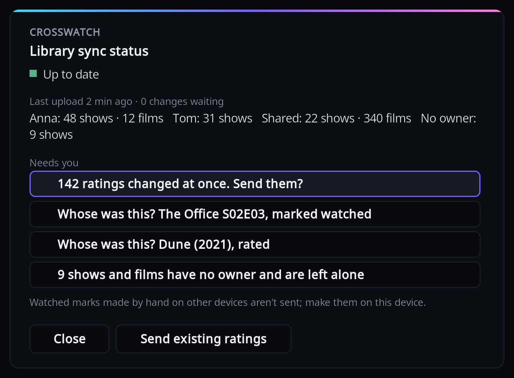
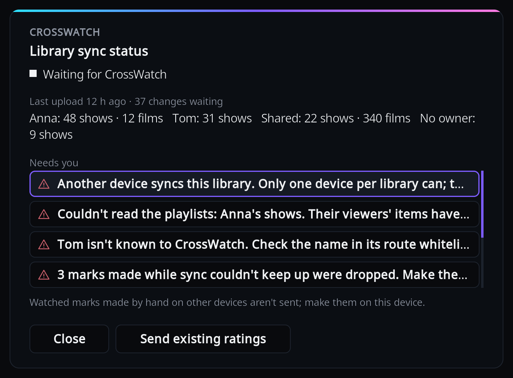

# Library sync

Library sync keeps Kodi's library and your services in step, per viewer. What a viewer's
services know (watched, play count, ratings, where they stopped) is written into Kodi for the
items that viewer owns. What someone marks or rates by hand in Kodi goes the other way, to
that person's services.

Without library sync, the add-on only reports playback. That stays as it is: playback keeps
going to CrossWatch as it happens, whether library sync is on or not.

!!! warning "Needs a CrossWatch release with library sync"

    Library sync needs CrossWatch 0.15.0 or newer. With an older CrossWatch, Set up library
    sync can still be run, but nothing syncs.

## How it works

Kodi boxes are not on all day, so CrossWatch never connects to Kodi. The add-on does the
talking, whenever Kodi runs:

1. It sends CrossWatch each viewer's state of the items they own.
2. CrossWatch runs its normal sync with that viewer's services (Trakt, Plex and the like) and
   queues what Kodi should change.
3. The add-on fetches those changes, writes them into Kodi's library, and confirms them.

One Kodi device per library does this: the **sync device**. Other Kodi devices that share the
library keep reporting playback as before, but do not sync.

## Before you start

- **Paired** with CrossWatch. See [Connect to CrossWatch](connect.md).
- **Viewers set up**, with the playlists that say whose shows are whose. See
  [Viewers](viewers.md). Library sync uses them to decide who owns what (next section), so
  check them first: an item with the wrong owner gets the wrong person's history.
- **A service for each viewer**, connected in CrossWatch (for example Trakt, an account per
  person). You link each viewer to it in CrossWatch after Start: see
  [Link each viewer in CrossWatch](#link-each-viewer-in-crosswatch).
- **One sync device** chosen. On a library shared by several Kodi devices (a MySQL or MariaDB
  library), set library sync up on one of them only.

## Who owns what

Each item in Kodi's library belongs to one or more viewers, decided much like
[who watched](who-watched.md), first match wins:

1. **Playlists.** A show or film in a viewer's playlist is theirs.
2. **Profiles.** A viewer linked to the current Kodi profile owns everything, but only when that
   profile has its own library. On a shared MySQL or MariaDB library, profiles do not count.
3. **Remembered answers.** A show with a [remembered answer](remembered-answers.md) belongs to
   the viewers in that answer. Films have no remembered answers.
4. **The only viewer.** In a household with one viewer, that viewer owns everything.

What that gives:

- **One owner.** The item syncs with that viewer's services.
- **Several owners** (shared). The item syncs for each of them. In Kodi it shows as watched when
  every owner has watched it, or when any owner has: the "A shared item counts as watched when"
  setting decides. A rating is written into Kodi only when all owners gave the same score.
- **No owner.** The item is left alone: nothing about it is sent, and sync never changes it in
  Kodi.

## Set it up

In the add-on settings, Library sync category, choose **Set up library sync**. Kodi shows a busy
spinner while the add-on reads the library and the playlists, then:

- **The counts** show how the library splits: each viewer's own shows and films, the shared
  ones, and those with no owner. Check them before you start.
- **Also send Kodi's existing ratings where CrossWatch has none**, off by default. See
  [Existing ratings](#existing-ratings).
- **Notes**: never copy this device's id (see below), and, when they apply, that Trakt for Kodi
  is installed (see [Limits](#limits)) or that the paired address is `http://`, so history and
  the token travel unencrypted.

**Start** turns library sync on for this device. **Cancel** changes nothing.

What the first Start does:

- What Kodi shows for items with one owner (watched, play count, last played, resume point)
  goes up as that owner's history. That happens only for the viewers there at that Start, and
  only if their first full sync begins within a day of Start, or of CrossWatch first syncing
  that viewer when that is later (a viewer linked days after Start still gets it). A viewer
  whose first full sync comes later than that starts empty, and the status screen says so.
- Shared items start empty: their owners' services fill them in.
- A viewer added later starts empty too. Their history comes from their services, never from
  what Kodi shows.
- It turns on "Sync this library with CrossWatch". A viewer's first full sync follows once
  CrossWatch syncs that viewer: straight away in a household with one viewer, otherwise once
  the viewer is linked (see [Link each viewer in CrossWatch](#link-each-viewer-in-crosswatch)).
- It sends nothing to your services by itself, and changes nothing in Kodi straight away:
  changes come in through the sync that follows.

Running Set up library sync again shows **Start library sync again**. That Start sends nothing
from Kodi's history: each viewer's record carries on. The exception is a lost record (`sync.db`
gone or unreadable): then the new record is filled from Kodi's history as at the first Start.

!!! warning "Don't copy the device id"

    CrossWatch knows the sync device by the add-on's device id (Settings, CrossWatch category,
    "Device id", Advanced level). Two devices set to the same id both pass as the sync device.
    Leave it blank on every device, or give each its own.

If a playlist cannot be read, the setup screen says which one and offers only **Close**: who
owns what cannot be decided without it. Fix the playlist (see
[A playlist shows as unusable](troubleshooting.md#a-playlist-shows-as-unusable)) and open it
again. It also stops with a message when the add-on is not paired, when there are no viewers,
or when Kodi's library cannot be read (for example during a library scan).

### Link each viewer in CrossWatch

Each viewer needs a sync pair in CrossWatch between their service and this Kodi. The quickest
way, after Start: in CrossWatch's Kodi panel, the **Library sync** card lists this Kodi's
viewers. They show up within five minutes of Start; reload the page if the card doesn't show
them yet. Pick the service each viewer syncs with and press **Set up sync**. CrossWatch adds
the viewer where needed and a two-way pair between that service and this Kodi, for history and
for ratings where the service has them. You can edit that pair later like any other, or make
the pairs by hand instead.

Until a viewer has a pair, nothing reaches their services. With one viewer, the add-on already
uploads after Start, so the status screen can say up to date before anything has gone
anywhere. With several, nothing syncs for a viewer until they are linked, and while none is,
the status screen says CrossWatch syncs none of this Kodi's viewers.

The pair Set up sync adds leaves out two things. Turn them on in the pair if you want them:

- **Resume points**, both ways, need the pair to sync progress (where the service supports it).
- **Removals.** With removals off in the pair, an unwatch or a cleared rating made in Kodi does
  not stick, even with "Send removals made in Kodi" on: the service keeps the watch or the
  rating, and the next sync puts it back into Kodi. Removals need both: removals on in the pair
  and "Send removals made in Kodi" on in the add-on.

### Existing ratings

Ratings already in Kodi are not sent by default: a service's own rating always wins. With the
tick box on, or **Send existing ratings** on the status screen, Kodi's rating goes to the
services for items:

- with one owner,
- whose history went up from Kodi at the first Start,
- where the service has no rating yet.

It waits until the first sync round has settled, at least 40 minutes after the first full
sync, so the services' own ratings are in first.

## When it syncs

Sync runs in the background and never holds up playback.

- **A full sync**, every item each viewer owns: when Kodi starts or wakes, after a library scan,
  once a day, after the first Start, and when CrossWatch's viewers change. Also for each
  viewer who gains or loses an item: a playlist edit counts once the add-on re-reads the
  playlists (every hour by default, see "Playlist refresh interval" in
  [Settings](settings.md)), a new or changed remembered answer shortly after. A viewer
  who gains an item starts with no history for it; their services fill it in.
- **Changes made in Kodi** go up to CrossWatch shortly after they are made, and CrossWatch
  passes them on to your services about a minute later; changes made within that minute go
  together. Ratings are checked every five minutes.
- **Changes from your services** are fetched when CrossWatch says it has some (the add-on asks
  with every heartbeat, every five minutes), and at least every 15 minutes.

Sync waits while something plays and for a minute after, during a library scan, while the
who-watched or rating question is open, and while a playlist cannot be read. A mark made
during playback goes up about a minute after it stops. Writes into Kodi go in small batches,
so Kodi stays responsive.

## What changes in Kodi

| What | From your services to Kodi | From Kodi to your services |
|---|---|---|
| Watched and play count | Yes. The play count only goes up, unless an unwatch is applied. | A watched mark made by hand on this device. |
| Last played | Yes, the newest. | With the watched mark. |
| Unwatched | Only with "Send removals made in Kodi" on, and removals on in the pair. | Only with "Send removals made in Kodi" on, and removals on in the pair. |
| Rating | Yes; a shared item only when all owners agree. A cleared rating only with "Send removals made in Kodi" on, and removals on in the pair. | A rating changed in Kodi; a cleared rating only with "Send removals made in Kodi" on, and removals on in the pair. |
| Resume point | Items with one owner only, when the pair syncs progress. | At the first Start, when the pair syncs progress; after that through playback, as before. |

A resume point from a service never overwrites one from playback on this Kodi in the week
before: that play may be newer than what the service knows.

Nothing sync does removes a watch or a rating, from Kodi or from a service, except an unwatch
or a cleared rating, made in Kodi or on a service, with "Send removals made in Kodi" on and
removals on in the sync pair in CrossWatch.

### Changes on shared items

A watched mark or rating made by hand on a shared item is not sent until you say whose it was.
It waits on the status screen as "Whose was this?". Pick the viewers it belongs to, and it goes
to their services.

## The status screen

In the add-on settings, Library sync category, choose **Library sync status**.

From the top:

- **The state**, with a coloured mark: green when up to date, white while syncing or waiting,
  red when stopped. A stopped state says what to do.
- **Last upload** and how many changes have not gone up yet.
- **Who owns what**, as on the setup screen, as of the last full sync.
- **Needs you**: problems first, marked with a warning sign, then things to answer. Rows that
  do not fit scroll. Select a row:
    - a problem shows its full text.
    - **Whose was this?** asks which viewers a change on a shared item was for. Done sends it
      to them; Skip leaves it on the list.
    - **`<n>` ratings changed at once** asks whether to send a batch of rating changes the
      add-on held back (see [Limits](#limits)). Send passes them on; Don't send drops them.
      Back leaves the question for later.
    - **`<n>` shows and films have no owner** lists them.
- **Send existing ratings**: see [Existing ratings](#existing-ratings).

After each answer the screen opens again. An answered row stays off the list while the add-on
takes it, which can take a moment.

What each state and problem means, and what to do, is in
[Troubleshooting](troubleshooting.md#library-sync).

## Settings

The Library sync category of the add-on settings holds the two screens and three settings:
whether this device syncs, whether removals are applied and sent, and when a shared item counts
as watched. See [Settings](settings.md#library-sync) for each, with its default.

## Limits

- **Marks made on other devices aren't sent.** Watched marks made by hand on another Kodi, even
  one sharing the library, are not seen here. Make them on the sync device. Ratings are the
  exception, on a shared library: see the next point.
- **On a shared library, a rating set on another device** is credited to the item's owner on
  this device.
- **Marks made while sync is off or paused** are not kept, and are not sent later.
- **Marks made during a library scan** aren't sent: Kodi's scan changes look the same.
- **A mark on the item playing**, or just played, counts as playback, not as a mark.
- **Add-ons that write play counts**, such as Trakt for Kodi, look like a person's mark: what
  they write is sent as the owner's history. The setup screen warns when Trakt for Kodi is
  installed.
- **Media server add-ons.** Items PlexKodiConnect or Jellyfin for Kodi put in the library are
  left out, with add-on paths (`plugin://`) and with direct paths: for direct paths, the add-on's
  own list of its items (`plex.db` or `jellyfin.db`, next to Kodi's library) says which they are.
  Your server add-on keeps syncing them with your server. That list is used only with Kodi's own
  library file; with an `advancedsettings.xml` that gives the video database another name or
  folder, direct-path items are synced like any other. Emby for Kodi is left out in add-on mode
  only; items it adds with direct paths are synced like any other.
- **Shared items at the first Start** go up empty, not with what Kodi shows. A watch that exists
  only in Kodi, on no service, stays unknown to the services.
- **Resume points** are written only for items with one owner: Kodi holds one per file.
- **Ratings from your services** are written into Kodi whatever the rating question's "Write the
  rating to Kodi's library" setting says.
- **Playback that never reached CrossWatch** stays only in Kodi: for example with live scrobble
  off for that viewer in CrossWatch, or a finished watch dropped after seven days of CrossWatch
  being unreachable (see [What the add-on sends](what-is-sent.md#when-crosswatch-cannot-be-reached)).
- **Many rating changes at once** (more than 50 in one check, as after restoring Kodi's database
  from a backup) are held until you answer on the status screen.
- **Marks waiting to go up** are kept for up to 30 days, and at most 10,000 (the oldest go
  first). A mark on an item Kodi has since replaced is dropped. The status screen says how many
  were dropped.
- **On a shared library, another device may be the sync device.** This device then waits, and
  takes over by itself when that device turns library sync off.
- **A paused device stays paused** until you run Set up library sync on it again: after "Sync
  this library with CrossWatch" was turned off, or when CrossWatch says another device of this
  pairing is the sync device.
