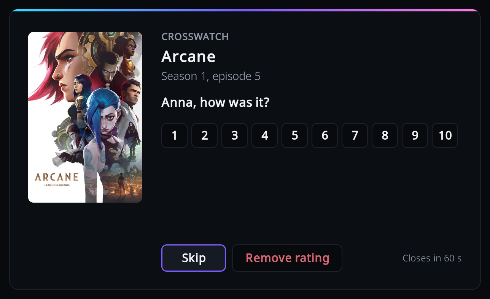

# Rating

After you finish watching something, the add-on can ask how it was and send your score to
CrossWatch.

## What you need

The settings are in the add-on's settings, in the Viewers category, after "Ask who watched a film"
(see [Settings](settings.md#viewers)):

- "Ask for a rating": Off, Films, Episodes, or Films and episodes. The default is Off, so nothing
  is asked until you switch it on.
- "When to ask": shown when "Ask for a rating" is not Off. "After each watch" (the default), or
  "At the end, for everything watched".
- "Shared rating": shown when "Ask for a rating" is not Off. Off by default. See [Who is
  asked](#who-is-asked).
- "Write the rating to Kodi's library": shown when "Ask for a rating" is not Off. Off by
  default. See [Kodi's own rating](#kodis-own-rating).

CrossWatch needs a version that supports ratings; an older one ignores them. Where a rating ends
up is decided by CrossWatch (see [Where ratings go](#where-ratings-go)).

## When it asks

A rating is asked only for an item that Kodi counts as watched (played to the end, or past
Kodi's watched threshold, 90 percent by default), of a kind you switched on, and that the
add-on reports (an episode or film with an id, see [What the add-on
sends](what-is-sent.md)).

With "After each watch", the question comes when playback stops and stays stopped. If the
who-watched question was asked, the rating question comes after it. When the next item starts
right away (a binge, or autoplay), the one that ended is not rated; the last one is.

With "At the end, for everything watched", every finished watch is collected, including those
that autoplay passed over. When playback stops for good, each one is asked, newest first. The
list is kept only while Kodi runs, so closing Kodi forgets what was not yet asked.

It is not asked:

- when the who-watched question was asked and skipped or left to time out.
- while another dialog is open.
- while Kodi is shutting down.
- for a viewer who was credited for the watch but has since been removed from the viewers. A
  watch whose credited viewers are all gone is not asked about at all.

## Who is asked

The question goes to the viewers the watch was credited to: by smart playlist, Kodi profile, a
remembered answer, the who-watched answer, or because they are the only viewer (see [Who
watched](who-watched.md)).

- With "Shared rating" off, each credited viewer gets their own question, "`<name>`, how was
  it?", one after the other. Each can be skipped.
- With "Shared rating" on, there is one question, "How was it?", and the score goes to every
  credited viewer.
- When nobody was credited there is also one question, "How was it?", and the score is sent
  with no viewer. Only CrossWatch routes without a username whitelist receive it.

## The window

The rating window shows the poster (or "No poster"), the title, "Season N, episode M" or the
year, and the question. Below are a row of scores from 1 to 10 and the buttons "Skip" and
"Remove rating". A countdown in the corner ("Closes in N s") runs from 60 seconds.

Focus starts on "Skip", so pressing OK straight away sends nothing. Press Up to reach the
scores, and Left and Right to move along them. While a score has focus, its word shows at the
right of the question, for example "8 · Great".

The words are: 1 Awful, 2 Very bad, 3 Bad, 4 Poor, 5 Average, 6 Fair, 7 Good, 8 Great,
9 Superb, 10 Masterpiece.

- OK on a score sends it and closes the window.
- "Remove rating" sends a request to remove that viewer's rating.
- "Skip", Back, the countdown running out, and playback starting send nothing.

With several questions in a row, the top right shows where you are, for example "2 of 3".
Playback starting ends the whole run: no further questions are asked.

## Kodi's own rating

By default the score goes to CrossWatch only. With "Write the rating to Kodi's library" on, the
add-on also sets Kodi's own user rating, for items that are in Kodi's library.

After the last question for a watch, if the scores given are all the same, that score is written
as Kodi's user rating. That is the case with a shared rating, with one viewer, with several
viewers who agreed, or where the others skipped. A removal with no other score clears it. If the
scores differ, Kodi's rating is left alone.

!!! note

    On a shared MySQL/MariaDB library, every profile and every Kodi device using that library
    sees the same user rating.

## Where ratings go

CrossWatch decides which of your connected services receive a rating, and the add-on cannot
change that.

| Destination | Films | Episodes | Note |
|---|---|---|---|
| Trakt | yes | yes | |
| Plex | yes | yes | The title must be in the Plex library. |
| MDBList | yes | yes | |
| CrossWatch tracker | yes | yes | |
| Floppy | yes | yes | Needs a TMDb id. |
| Scrob | yes | yes | Needs a TMDb id. |
| PunchPlay | yes | yes | |
| FlickList | yes | yes | |
| WeTrakr | yes | yes | |
| Simkl | yes | no | No episode ratings. |
| AniList | yes | no | Scores a whole anime entry. |
| Kitsu | yes | no | Scores a whole anime entry. |
| MyAnimeList | yes | no | Scores a whole anime entry. |
| Emby | no | no | Takes no rating. |
| Jellyfin | no | no | Takes no rating. |
| Kodi | no | no | Takes no rating. |
| BingeBase | no | no | Takes no rating. |

If a rating does not arrive, see [Ratings do not arrive](troubleshooting.md#ratings-do-not-arrive).
