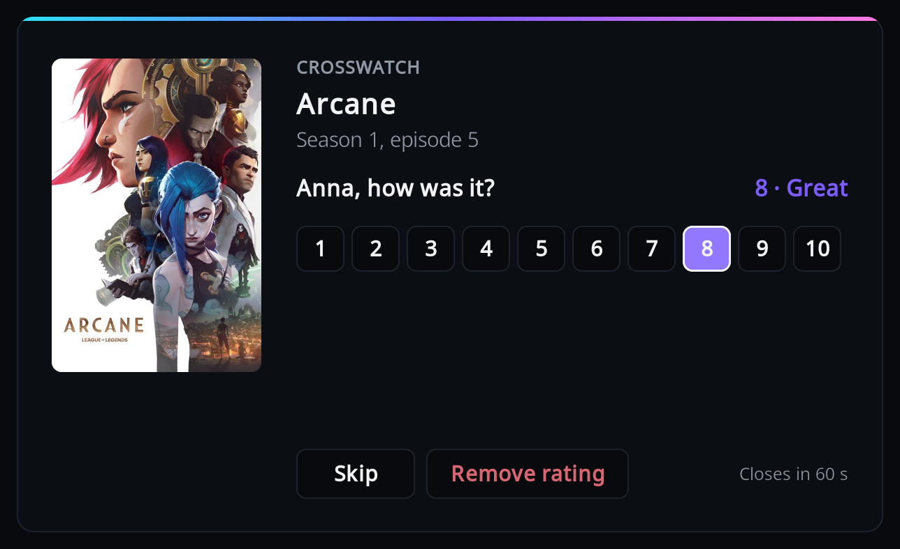

# Rating

After you finish an episode or a film, the add-on can ask how it was and send the score to
CrossWatch, which passes it on to services such as Trakt or Plex.

This needs a CrossWatch release newer than v0.13.3; an older one ignores ratings.

## Switch it on

In the add-on settings, Viewers category, set "Ask for a rating" to Films, Episodes, or Films
and episodes. It is Off by default. Three more settings then appear:

- **When to ask**: "After each watch" (the default) asks every time playback stops. "At the end,
  for everything watched" saves the questions up while you binge, and asks them all once you
  stop.
- **Shared rating**: one question for everyone who watched, instead of one per person. Off by
  default.
- **Write the rating to Kodi's library**: also set Kodi's own user rating. Off by default; see
  [Kodi's own rating](#kodis-own-rating).

## When it asks

Only after a watch that Kodi counts as finished: played to the end, or past Kodi's watched
threshold (90 percent by default). If the [who-watched question](who-watched.md#the-question-at-the-end)
is asked too, the rating question comes after it.

With "After each watch", an episode that autoplay moved on from is not rated; only the last one
before you stopped is. With "At the end, for everything watched", every finished watch is
collected and asked about when playback stops, newest first. The collection lives only while
Kodi runs: closing Kodi drops the questions not yet asked.

It is not asked:

- when the who-watched question was skipped or ran out of time.
- for a viewer who has since been removed.
- while another dialog is open, or while Kodi is shutting down.
- for anything the add-on does not report (see [What the add-on sends](what-is-sent.md)).

## Who is asked

Everyone the watch was credited to, however that was decided (see [Who watched](who-watched.md)):

- With "Shared rating" off, each person gets their own question, "`<name>`, how was it?", one
  after the other, and each can skip.
- With "Shared rating" on, one question, "How was it?", and the score goes to everyone credited.
- When nobody was credited, one question, "How was it?", and the score is sent with no viewer.
  Only CrossWatch routes with an empty username whitelist receive it.

## Giving a score

Focus starts on Skip, so pressing OK straight away sends nothing. Press Up to reach the scores
and Left or Right to choose; the word for the score shows next to the question:

1 Awful, 2 Very bad, 3 Bad, 4 Poor, 5 Average, 6 Fair, 7 Good, 8 Great, 9 Superb,
10 Masterpiece.

- OK on a score sends it.
- "Remove rating" asks CrossWatch to remove this person's rating.
- Skip, Back, or doing nothing for a minute sends nothing.

Starting playback closes the window and cancels any questions still to come.

## Kodi's own rating

With "Write the rating to Kodi's library" on, the add-on also sets Kodi's user rating for the
item, if it is in Kodi's library. Kodi has one user rating per item, so it is only written when
everyone who scored agrees: a shared rating, a single viewer, viewers who gave the same score,
or one score with the rest skipped. If the scores differ, Kodi's rating is left alone. "Remove
rating" with no other score clears it.

!!! note

    On a shared MySQL/MariaDB library, every profile and every Kodi device using that library
    sees the same user rating.

## Where ratings go

CrossWatch decides which of your connected services receive a rating; the add-on has no say.
The table reflects CrossWatch when this page was written:

| Destination | Films | Episodes | Note |
|---|---|---|---|
| Trakt | yes | yes | |
| Plex | yes | yes | The title must be in the Plex library. |
| MDBList | yes | yes | |
| CrossWatch tracker | yes | yes | |
| Floppy | yes | yes | Needs a TMDb id. |
| Scrob | yes | yes | Needs a TMDb id. |
| PunchPlay | yes | yes | |
| FlickList | yes | yes | |
| WeTrakr | yes | yes | |
| Simkl | yes | no | |
| AniList | yes | no | Scores a whole anime entry. |
| Kitsu | yes | no | Scores a whole anime entry. |
| MyAnimeList | yes | no | Scores a whole anime entry. |
| Emby, Jellyfin, Kodi, BingeBase | no | no | They take no rating. |

If a rating does not arrive, see [Ratings do not arrive](troubleshooting.md#ratings-do-not-arrive).
