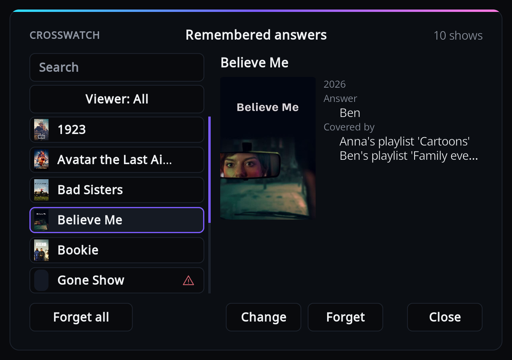
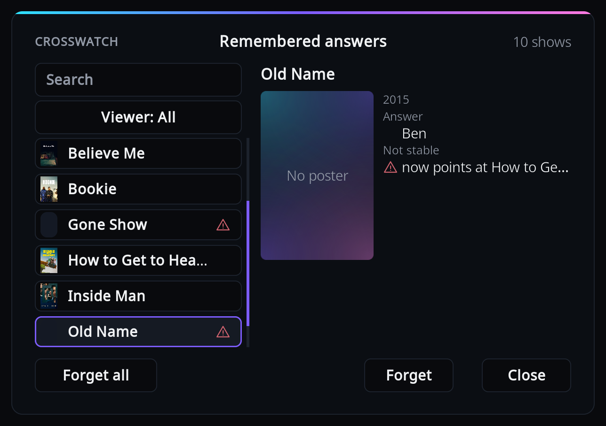

# Remembered answers

When you answer [the question at the end](who-watched.md#the-question-at-the-end) for an episode,
the add-on remembers who watched that show and stops asking. This window lets you check those
answers, correct a wrong one, or forget one so the question comes back.

Open it from the add-on settings: Viewers > "Remembered answers". With nothing remembered yet,
you get the notice "No remembered answers yet." instead.

Pick a show on the left to see its answer on the right. To find a show, use the search box (it
matches show titles and viewer names), or press "Viewer" to cycle through the viewers and "will
ask again", which lists the shows whose answer no longer names any configured viewer. A show
whose title is unknown is listed by its id, such as "tvdb 81189" or "Kodi library id 12".

## Change or forget an answer

- **Change** opens the who-watched window with the current answer ticked. Tick the right
  people and press Done. Done with nobody ticked forgets the answer; Skip or Back changes
  nothing.
- **Forget** removes the answer after you confirm. The question is asked again at the end of
  the show's next episode.
- **Forget all** forgets every show in the list after you confirm. While a search or viewer
  filter is active it reads "Forget N shown" and forgets only the shows listed.

Changes apply from the next playback.

## What the details mean

- **Answer**: the viewers credited for this show. "will ask again" means none of them is a
  viewer any more, so the question comes back.
- **Covered by**: a viewer's playlist contains this show, and [playlists win over remembered
  answers](#when-a-remembered-answer-is-not-used). The answer is kept, and used again if the
  show ever leaves the playlist.
- **Not in library** (warning icon): the show is no longer in your Kodi library. Forget it if
  you removed the show for good.
- **Not stable** (warning icon): the show had no scraper id (such as TVDb or TMDb), so the
  answer was stored against Kodi's internal library number, and that number now belongs to
  another show ("now points at `<other show>`") or cannot be checked ("no title stored to
  check it"). Such an answer can only be forgotten; you are asked again next time.

## When a remembered answer is not used

Playlists and the Kodi profile are checked first, so either one overrides a remembered answer.
Only a playlist is shown as "Covered by"; a show decided by the Kodi profile has no mark here.

If the wrong person is credited for a show marked "Covered by", fix the playlist, not the
answer. A playlist should describe what that person watches, not what was played last; see
[Smart playlists](who-watched.md#smart-playlists).
