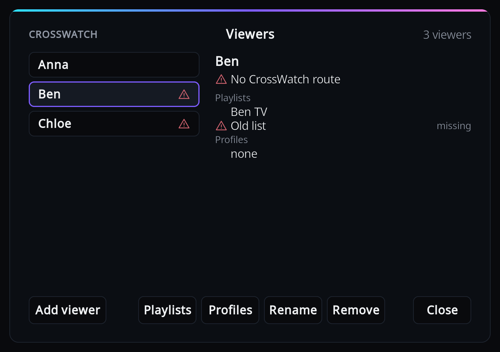
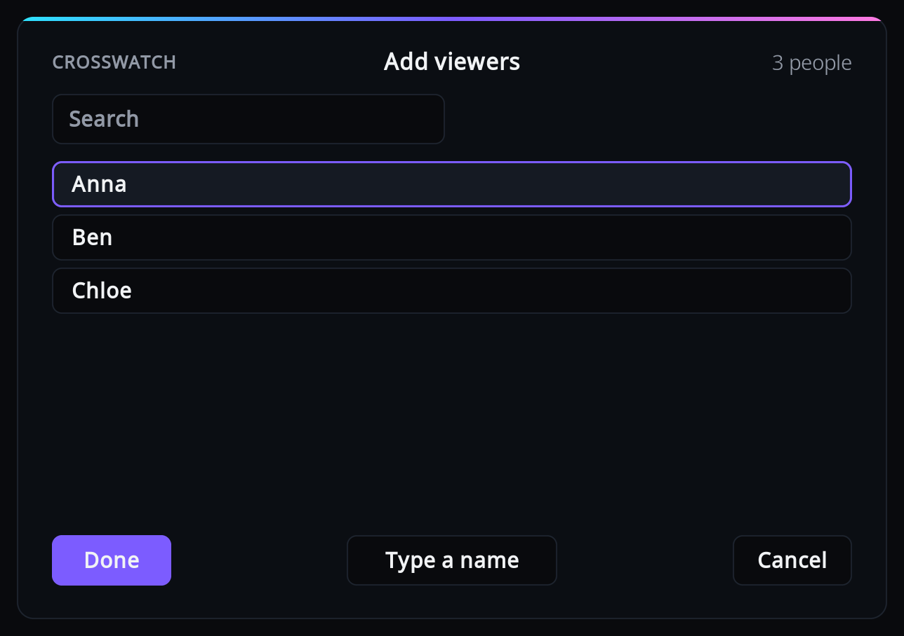
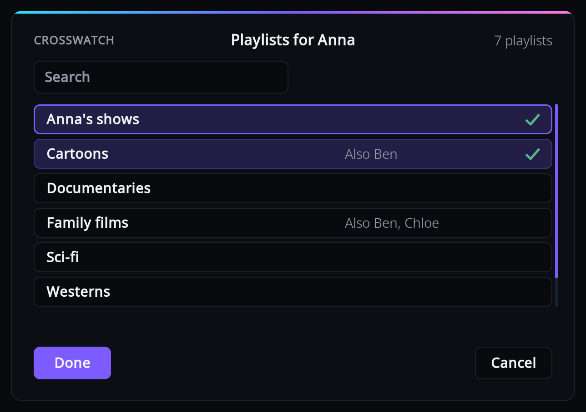

# Viewers

Add one viewer per person in the household, and tell the add-on how to recognise each of them:
by smart playlists, by Kodi profiles, or neither (then the add-on asks at the end of playback).
[Who watched](who-watched.md) explains how these are used.

Open it from the add-on settings: Viewers > "Configure viewers and playlists".

Pick a viewer on the left to see their CrossWatch route, playlists and profiles on the right.
The buttons along the bottom act on that viewer. Every change is saved at once and applies from
the next playback; there is nothing to confirm when you close the window.

A warning icon next to a viewer means something needs fixing; the right-hand side shows what.
See [What the warnings mean](#what-the-warnings-mean).

## Add a viewer

If CrossWatch has user profiles assigned to this Kodi's routes, Add viewer lists those people;
otherwise you type the name. Picking is the safer way: the name is CrossWatch's own, so it
cannot be mistyped, and it follows a rename in CrossWatch.

### Pick people from CrossWatch

1. Select "Add viewer" (with no viewers yet, the list opens straight away).
2. Tick everyone you want to add with OK, then press Done. Each ticked person becomes a viewer,
   except one whose name CrossWatch would confuse with a viewer you typed earlier: the add-on
   says "CrossWatch treats `<person>` as the same as the viewer `<viewer>`. Remove that viewer
   first, or rename the profile in CrossWatch." and skips that person. If a viewer you typed earlier already has a person's name, apart from case, ticking
   that person links the viewer to them instead of adding a second one: the viewer keeps its
   playlists and remembered answers, takes CrossWatch's spelling of the name, and is not asked
   for playlists again. A person whose name belongs to a viewer already linked to someone else
   is skipped without a message.
3. For each new viewer in turn, tick their playlists and press Done, or press Cancel to keep that
   viewer without playlists.

The list holds every CrossWatch user profile that is assigned to a route on this Kodi without a
username whitelist, minus the people already added. A route with a whitelist takes the names in
it rather than the profile's, so its profile is not listed. A profile shows up here once a route
on this Kodi is assigned to it in CrossWatch and the add-on has checked in, which it does every
five minutes. For someone who has no profile, select "Type a name".

The list needs CrossWatch v0.13.5 or newer; with an older CrossWatch, "Add viewer" always opens
the keyboard. A newer one opens the keyboard too when no route on this Kodi is assigned to a
profile, when everyone listed is already a viewer, when the add-on is not paired, or when it has
not checked in yet.

### Type a name

1. Select "Add viewer", then "Type a name" if the list of people opens (with no viewers and no
   people, the keyboard opens straight away). Anyone you ticked in that list is added first,
   with their playlists asked as after Done, and then the keyboard opens.
2. Type the person's name. It must match the name in that person's CrossWatch route
   "Username whitelist" (or, for a route without a whitelist, the name of the user profile it
   is assigned to), or CrossWatch has nowhere to send their playback.
3. Tick their playlists and press Done, or press Cancel to add the viewer without playlists.

A typed name that matches one of CrossWatch's people is linked to that person, just as if you
had picked them, and saved with the profile's exact spelling: typing "anna-lee" for the profile
"Anna Lee" adds the viewer "Anna Lee".

CrossWatch ignores upper and lower case, spaces and punctuation when it compares names, so
"Anna-Lee" and "annalee" are the same name to it. Accents and letters of any script count, so
"José" and "Jose" are two names. A name without any letter or digit, such as an emoji, is
compared as typed, apart from case and surrounding spaces. The add-on
therefore refuses a typed name that CrossWatch would confuse with an existing viewer:
"CrossWatch treats this name as the same as `<name>`. Choose another name." An empty name, or
an exact copy of an existing one, is refused without a message. Two people picked from
CrossWatch may differ only in spaces or punctuation, such as "Anna B." and "Annab", because
CrossWatch keeps two profiles like that apart.

## Give a viewer playlists

Select "Playlists". The list shows Kodi's smart playlists of TV shows and of films; other
kinds of playlist cannot be used and are not offered.

Tick or untick a playlist with OK, then press Done to save, or Cancel to change nothing. Use
the search box to narrow a long list; ticked playlists that the search hides stay ticked.

"Also Ben, Chloe" next to a playlist means those viewers have it too. Everything in a shared
playlist is credited to all of them, which is right for a family playlist and wrong for one
person's list.

The list is read when the Viewers window opens. If you make a new smart playlist in Kodi while
it is open, close the window and open it again to see it.

If Kodi has no smart playlists of TV shows or films at all, you get "Kodi has no smart
playlists of TV shows or films yet. Make one under Videos, Playlists, then come back here."
Make one in Kodi first, under Videos > Playlists, with the type TV shows or Movies.

## Give a viewer Kodi profiles

Select "Profiles". The list comes from Kodi, so there is nothing to type: tick the profiles that
belong to this person and press Done. A profile that another viewer already has shows "Also
`<names>`".

Profiles only help if each person really switches to their own Kodi profile. Note that each
Kodi profile also has its own copy of the add-on's settings; see the note under
[Kodi profile](who-watched.md#kodi-profile).

## Rename a viewer

Select "Rename" and edit the name. The same name rules apply as when adding one. The viewer's
remembered answers move to the new name.

!!! warning

    Change the name in the CrossWatch route's username whitelist too. Until you do, that route
    no longer receives this viewer's playback, and the viewer shows "No CrossWatch route".

### Viewers linked to CrossWatch

A viewer picked from CrossWatch, or whose name matches one of CrossWatch's people, is linked to
that person. Its panel shows "Name from CrossWatch", and it has no Rename button: a different
name would stop the route from receiving its playback.

To rename a linked viewer, rename the user profile in CrossWatch. At its next check-in the
add-on takes over the new name, shows a short "Renamed in CrossWatch" notification with the new name, and moves
the viewer's remembered answers and any finished watches still waiting for delivery to the new
name. If another viewer already has the new name, the add-on leaves both alone. Remove that
other viewer, or rename its profile in CrossWatch if it is linked, and the rename follows at
the next check-in.

Existing viewers whose names match one of CrossWatch's people are linked at the add-on's first
check-in with a CrossWatch that lists people, and take the profile's exact spelling. A viewer
typed as "anna-lee" for the profile "Anna Lee" becomes "Anna Lee", with the same message and
the same move of remembered answers and waiting watches as a rename. If another viewer already
has that spelling, the viewer is left unlinked and unchanged.

## Remove a viewer

Select "Remove" and confirm. The viewer's name is taken out of every remembered answer. A show
that was remembered only for this viewer is forgotten, so the question is asked again at the
end of its next episode.

## What the warnings mean

| You see | Meaning | What to do |
|---|---|---|
| "No CrossWatch route" | No route in CrossWatch accepts this viewer's name. | See [A viewer shows "No CrossWatch route"](troubleshooting.md#a-viewer-shows-no-crosswatch-route). |
| A playlist tagged "missing" | The playlist was deleted or renamed in Kodi. Until it is fixed, **none** of this viewer's playlists count. | Open "Playlists", untick it (it is at the end of the list), tick its replacement, press Done. |
| A playlist tagged "unusable" | It is not a playlist of TV shows or films, so it never credits anyone. The viewer's other playlists still count. | See [A playlist shows as unusable](troubleshooting.md#a-playlist-shows-as-unusable). |
| A profile tagged "missing" | Kodi no longer has that profile. | Open "Profiles", untick it, press Done. |

"CrossWatch route", with a check mark, means a route accepts the name. Neither line is shown
while the add-on is not paired, or until CrossWatch has reported its routes for that name. It
does so at the add-on's next check-in: every five minutes, and at once after you add or rename
a viewer.
