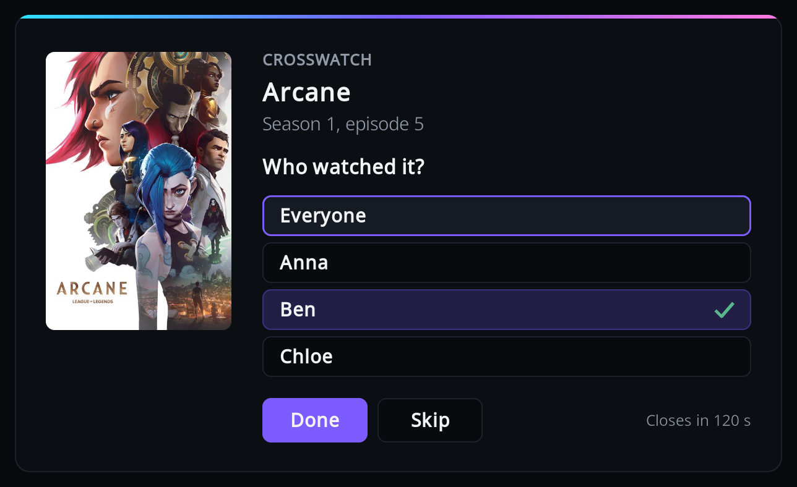

# Who watched

Kodi does not know who is on the sofa, so the add-on works it out for every playback. It tries
the methods below in order and stops at the first that names somebody. You set them up per
viewer in [Viewers](viewers.md).

1. [Smart playlists](#smart-playlists): the show or film is in a viewer's playlist.
2. [Kodi profile](#kodi-profile): the active Kodi profile belongs to a viewer.
3. [The question at the end](#the-question-at-the-end): Kodi asks, and for a show remembers the
   answer.

If nothing names anyone, the playback is sent with no viewer, and only a CrossWatch route with
an empty username whitelist accepts it.

## Smart playlists

Give each person a smart playlist of TV shows or films that describes what they watch. An
episode is credited to every viewer whose playlist contains its show; a film to every viewer
whose playlist contains the film.

- Works well: a fixed list of shows, or rules on genre, tag, studio and other things that do
  not change when you watch.
- Avoid playlists that change because of playback, such as "Continue Watching" or "In
  Progress" (rules on in progress, play count or last played). Whoever owns that playlist gets
  credited for the next episode of anything that was just played, whoever watched it.

The add-on reads playlist membership in advance: every hour by default ("Playlist refresh
interval", see [Settings](settings.md#advanced)), after a library scan or clean, and when you
change viewers or settings. It never re-reads during playback, only while nothing plays or
playback is paused. A show you add to a playlist counts from the next re-read.

If a viewer's playlist cannot be read, for example because it was renamed or deleted, Kodi shows
"Playlist could not be read, so viewer identification is reduced: `<playlist names>`". Until you
fix it, none of that viewer's playlists count, and the add-on falls back to the profile and the
question. See [What the warnings mean](viewers.md#what-the-warnings-mean).

## Kodi profile

If the active Kodi profile is one of a viewer's profiles, that viewer is credited. This only
helps in a household where each person switches to their own Kodi profile.

!!! note "Set up the add-on in every profile"

    Kodi keeps each add-on's settings per profile, so the add-on's connection, viewers and
    remembered answers are separate in every Kodi profile. Pair the add-on and set up viewers
    in each profile that should report playback.

## The question at the end

When neither playlists nor profile name anybody, Kodi asks who watched once playback stops.
It never asks at the start, so playback is never held up.

- Press OK on each person who watched; you can tick several. "Everyone" ticks them all (or
  clears them all when all are ticked).
- Press Done to send the watch with the people you ticked.
- Skip, Back, or Done with nobody ticked sends it with no viewer. Nothing is remembered, so you
  are asked again next time.

The window closes by itself after two minutes, or when playback starts again, as if you had
pressed Skip. The stop is sent to CrossWatch once the question is answered or closes.

**For a show, the answer is remembered** and used for its later episodes, from the moment they
start, so you are asked once per show. To see, change or forget these answers, use
[Remembered answers](remembered-answers.md). For a film nothing is remembered.

The question is not asked:

- with fewer than two viewers.
- for a film, when "Ask who watched a film" is off.
- when playback stopped in the first three minutes of the item (Kodi's "ignore at start"
  point, 180 seconds unless changed in Kodi's advanced settings). What counts is the position
  where it stopped, not how long you watched.
- when the next item starts straight away (binge watching or autoplay). The one that ended is
  sent with no viewer.
- while another dialog is open, or while Kodi is shutting down.

If [rating](rating.md) is switched on, the rating question follows this one.

## One person in the household

Add yourself as the only viewer, with no playlists or profiles. With exactly one viewer,
everything is credited to that viewer and no question is ever asked. The name must match the
username in your CrossWatch route's whitelist.

Having no viewers at all also works, if your CrossWatch route has an empty username whitelist:
every playback is then sent with no viewer.
